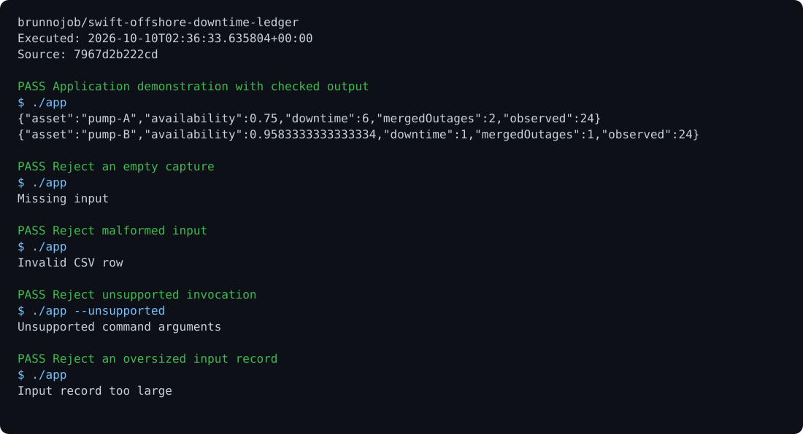

# swift-offshore-downtime-ledger

[View execution evidence](https://brunnojob.github.io/devstart-lab/proofs/swift-offshore-downtime-ledger/)

Merge overlapping outage windows and calculate asset availability without double-counting faults.

```sh
swiftc Sources/main.swift -o app
./app --self-test
./app < examples/input.txt
```

Offline diagnostic CLI built with Foundation. Sample records are synthetic; deployment needs measured data and installation-specific acceptance limits.

MIT. Built by [brunnodev](https://brunnodev.store).

## Execution proof

[](https://github.com/brunnojob/swift-offshore-downtime-ledger/actions/workflows/proof.yml)



[Verified run](https://github.com/brunnojob/swift-offshore-downtime-ledger/actions/runs/38018070176) · [Execution report](docs/proof/evidence.json)

Run `python .proof/record.py` after installing the prerequisites above. The scenarios execute repository code and verify exit codes and expected output. CI publishes `execution-proof` with the transcript, input fingerprints and source commit. The downloadable report identifies the exact tested version; the workflow badge tracks the latest run.

## Co-authorship

Contribution trailer:

```text
Co-authored-by: nyctophile <33561761+ineedfoundmyway@users.noreply.github.com>
```
